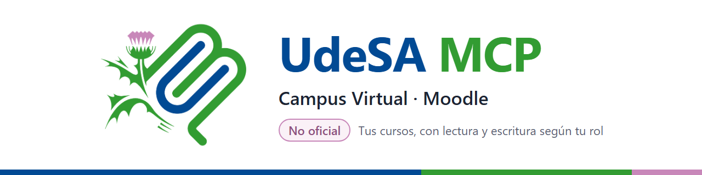

<p align="center"></p>

# udesa-mcp

MCP (Model Context Protocol) **no oficial** para el Campus Virtual (Moodle 5.1) de la Universidad de San Andrés. Le da a un agente (Claude Code, Codex, ChatGPT…) acceso a tus cursos con tu propia cuenta, sea cual sea tu rol: estudiantes y docentes leen lo suyo en todos sus cursos, y quien es docente o gestor en un curso además ve los datos de otras personas y puede escribir ahí. Las políticas de alcance y de escritura las aplica este servidor.

Funciona en dos modos con el mismo núcleo:
- **local** (STDIO): las credenciales quedan en el almacén seguro de tu sistema;
- **remoto privado** en Vercel: OAuth propio y login con GitHub, limitado a una sola cuenta (la tuya).

Cada resultado trae procedencia, cobertura y advertencias. Un error nunca se presenta como lista vacía.

> Proyecto personal, sin relación oficial con UdeSA. Usalo con tu propia cuenta y respetando las políticas de la universidad.

## Qué puede hacer

**Lecturas.** Todos los cursos donde la cuenta está matriculada, con cualquier rol (ADR-122):
- **Con cualquier rol:** contenido, archivos, foros, avisos, calendario, tus notas y tus intentos de cuestionarios y H5P. Los intentos se ven según las opciones de revisión de cada cuestionario (ADR-123).
- **Con rol docente o superior** (`editingteacher`, `teacher`, `manager` o `coursecreator`) en ese curso, también los datos de terceros:
  - entregas, notas, intentos, participantes (con email, legajo, país, descripción y foto, ADR-124), grupos, asistencia y pendientes;
  - con sesión web, estructura de cuestionarios, preguntas y reportes.

**Escrituras.** En todos los cursos donde tu rol es de profesor, gestor o superior (`editingteacher`, `manager` o `coursecreator`), con las capacidades del perfil de escritura (ADR-125). Conviene probar cada capacidad primero en un curso de pruebas (sandbox). Cubren:
- foros (avisos, respuestas, edición, adjuntos, moderación);
- calendario;
- tareas: prórrogas, excepciones, bloqueo y comentarios de entregas;
- calificación de tareas, foros y preguntas: a mano, con escala, rúbrica o guía, y con archivos de retroalimentación;
- libro de calificaciones y asistencia;
- cuestionarios: crear, importar preguntas, armarlos por páginas y secciones, overrides, estado de preguntas;
- contenido: páginas, enlaces, etiquetas, archivos, foros y fechas de actividades;
- estructura: mostrar, mover, renombrar, secciones;
- grupos, agrupamientos y elecciones de grupo;
- cada tipo de elemento: carpetas, libros, wikis (también por grupo o individuales), glosarios, consultas, bases de datos, lecciones, encuestas y más ([docs/SANDBOX_ELEMENTOS.md](docs/SANDBOX_ELEMENTOS.md));
- **contenido H5P generado por el MCP** (ADR-110 y 111): cuestionarios, presentaciones, libros, videos interactivos, escenarios ramificados, tarjetas, gráficos, líneas de tiempo y acordeones desde un esquema tipado, también en el remoto;
- **laboratorio en Vercel** (ADR-116 y 117): ejercicios de Python con pruebas automáticas, incrustados o como actividad LTI con nota en el libro de calificaciones;
- borrados (R4), también en lote, de intentos de cuestionario y de entregas de estudiantes (ADR-119).

**Reglas de las escrituras:**
- Toda escritura se planifica primero (`campus_plan_*`), se ejecuta con `campus_execute_plan` y se verifica releyendo el Campus. Muchas se pueden deshacer.
- Hasta 2000 escrituras por día (ADR-078).
- No hay aprobación fuera del chat (ADR-061). Para R3 y R4 decide el humano: el agente le plantea la acción y sólo ejecuta con su aprobación, o el servidor se la pregunta por elicitación (ADR-118).
- No se notifica a estudiantes reales (`allow_participant_notifications: false`). Excepciones:
  - aprobar una entrada de glosario puede avisar al autor (ADR-089);
  - avisos de calificación y mensajes privados a las cuentas de prueba de tu sandbox (`notifiable_user_ids`, ADR-115 y 120). El perfil publicado trae esa lista y la del sandbox vacías: se completan con los tuyos ([PROCESOS.md](docs/PROCESOS.md#escrituras)).

**Sesión web automática** (opcional, no recomendada; ADR-087, ADR-088 y ADR-127). Donde el keepalive no es viable, el MCP local y el remoto pueden iniciar sesión en la web solos, con la contraseña guardada y un dispositivo de confianza de 28 días (el MFA por correo se pide sólo al activarlo o renovarlo).

## Cómo funciona

- Login **nativo** (usuario/contraseña → `login/token.php`) ejecutado por el humano en su terminal. La contraseña no se guarda; el token va al almacén seguro del sistema (Administrador de credenciales en Windows). Excepción opcional y no recomendada: el login web automático guarda la contraseña en ese mismo almacén, y sólo si lo activás vos (ADR-088, [PROCESOS.md](docs/PROCESOS.md#login-web-automático-opcional-no-recomendado)).
- Valida el token con `core_webservice_get_site_info` (sitio + `userid`) antes de guardarlo.
- Reporte de capacidades con cuatro dimensiones: anuncio del servicio, implementación local, política local y prueba en contexto.
- Alcance verificado antes de cada consulta: curso permitido → rol en ese curso (los datos de terceros exigen rol docente o superior) → actividad del curso → participante matriculado. Los Avisos se detectan por `type=news`, nunca por un ID inventado.
- El servidor de lectura (`serve`, `/mcp`, perfil `docente-lectura`) **no** registra herramientas de escritura; las escrituras están en `docente-completo` (`serve-full`, `/mcp-completo`) o en `serve-write` / `/mcp-escritura` (ADR-044, ADR-062). Ningún servidor expone una tool genérica de `wsfunction`, AJAX ni URL, no llama funciones `*_view_*`, no lee Gmail ni automatiza Google. Única excepción aceptada sobre el estado de lectura: al leer un hilo completo (o buscar en respuestas) de un foro con seguimiento de no leídos, Moodle marca esos posts como leídos para tu cuenta; la respuesta lo declara y `avoid_mark_read` lo evita (ADR-039). Listar avisos y leer los adjuntos del primer post no marca nada. Las operaciones con efectos laterales están auditadas una por una ([docs/HERRAMIENTAS.md](docs/HERRAMIENTAS.md#operaciones-admitidas-y-efectos-auditados)).
- Login **browser** (Google institucional): `auth login --method browser` abre tu navegador normal, hacés el login con Google y pegás en la terminal el enlace de retorno. El retorno automático para Windows (`auth handler install`) está **en pausa**: funciona en un Chrome limpio, pero no en todos los perfiles de Chrome. Paso a paso: [docs/LOGIN_GOOGLE.md](docs/LOGIN_GOOGLE.md); diseño: [docs/AUTH_BROWSER.md](docs/AUTH_BROWSER.md).
- **Sesión web** opcional para las lecturas que el servicio móvil no ofrece. Hay tres formas de tenerla:
  - importar la cookie `MoodleSession` (el humano);
  - mantenerla viva con el keepalive;
  - con el login web automático (opcional, no recomendado; ADR-088 y ADR-127).

  Sin sesión web, esas herramientas devuelven `AUTH_REQUIRED` y el resto funciona igual.

## Empezar

Requisitos: Node ≥ 22. El sistema validado es Windows 11 (con Node 25); en macOS y Linux debería funcionar, sin validar y sin los diálogos de Windows ([CONFIGURACION_LOCAL.md](docs/CONFIGURACION_LOCAL.md#entornos)). Dependencias fijadas en `package-lock.json`.

```bash
git clone https://github.com/changazo/udesa-mcp.git
```

```bash
cd udesa-mcp
npm ci
npm run build
npm test
```

Después: iniciá sesión con `auth login` y conectá tu cliente MCP siguiendo [docs/CONFIGURACION_LOCAL.md](docs/CONFIGURACION_LOCAL.md). Para el servidor remoto propio en Vercel: [docs/REMOTO_VERCEL.md](docs/REMOTO_VERCEL.md).

Los perfiles sirven con cualquier rol. Sus nombres (`udesa-docente`, `docente-lectura`, `docente-completo`) son históricos: `docente-lectura` sólo lee y `docente-completo` además escribe donde tu rol lo permite.

## Comandos

```text
node build/cli.js profile check --profile udesa-docente
node build/cli.js auth login    --profile udesa-docente --method native   # lo corre el humano, en una terminal interactiva
node build/cli.js auth login    --profile udesa-docente --method browser  # Google institucional, en tu navegador (retorno pegado a mano)
node build/cli.js auth status   --profile udesa-docente [--verify]
node build/cli.js diagnose      --profile udesa-docente [--appsitecheck]
node build/cli.js serve         --profile udesa-docente                   # lo inicia el cliente MCP (sólo lectura)
node build/cli.js serve-full    --profile docente-completo                # lecturas + escrituras; exige CAMPUS_WRITE_ENABLED=true
node build/cli.js auth logout   --profile udesa-docente --local           # borra local; NO revoca en Moodle
node build/cli.js auth web import --profile udesa-docente                 # sesión web (cookie MoodleSession, entrada oculta)
node build/cli.js auth web status --profile udesa-docente [--verify]      # --verify también mide el límite de inactividad
node build/cli.js auth web keepalive [install|uninstall|status] --profile udesa-docente   # mantener viva la sesión web
node build/cli.js auth web autologin [enable|disable|status] --profile udesa-docente     # login web automático (opcional, no recomendado)
node build/cli.js remote push-token        --profile udesa-docente        # token móvil del keyring → Vercel
node build/cli.js remote push-web-session  --profile udesa-docente        # sesión web del keyring → Vercel
node build/cli.js remote autologin [enable|disable|status] --profile udesa-docente  # login web automático en Vercel (ADR-127)
```

Lista completa: `node build/cli.js` sin argumentos. Cuándo usar cada uno: [docs/PROCESOS.md](docs/PROCESOS.md).

`diagnose` hace sólo lecturas: identidad, cursos y, por cada curso del alcance del perfil, estructura, foros y los títulos de los 3 avisos más recientes (para compararlos con la web). Guarda un reporte de capacidades saneado (sin username ni contenido) en el directorio de estado del usuario (`%LOCALAPPDATA%\udesa-campus-mcp\profiles\<perfil>\` en Windows; `~/.local/state/udesa-campus-mcp/profiles/<perfil>/` en macOS y Linux).

## Documentación

| Documento | Contenido |
|---|---|
| [docs/PROCESOS.md](docs/PROCESOS.md) | **Procesos:** renovar credenciales, publicar cambios, incidentes, agregar y validar una lectura |
| [docs/HERRAMIENTAS.md](docs/HERRAMIENTAS.md) | Catálogo de herramientas por área, recorridos típicos, qué no se puede leer y efectos auditados |
| [docs/CONECTAR_CLIENTES.md](docs/CONECTAR_CLIENTES.md) | Conectar ChatGPT, Codex y Claude Code al remoto (también desde otra computadora) |
| [docs/CONFIGURACION_LOCAL.md](docs/CONFIGURACION_LOCAL.md) | Modo local (STDIO), keyring y sesión web |
| [docs/LOGIN_GOOGLE.md](docs/LOGIN_GOOGLE.md) | Login con Google paso a paso y qué hacer si el token se expone |
| [docs/AUTH_BROWSER.md](docs/AUTH_BROWSER.md) | Diseño y seguridad del login por navegador |
| [docs/REMOTO_VERCEL.md](docs/REMOTO_VERCEL.md) | Montar y operar el servidor remoto (variables, OAuth, renovar token) |
| [docs/DECISIONES.md](docs/DECISIONES.md) | Registro de decisiones (ADR) |
| [docs/H5P_EXPLORACION.md](docs/H5P_EXPLORACION.md) | H5P y micro-integraciones (ADR-109) |
| [docs/SANDBOX_ELEMENTOS.md](docs/SANDBOX_ELEMENTOS.md) | Qué se puede crear, editar y borrar por tipo de elemento (ADR-077) |

## Herramientas MCP

Las herramientas de lectura del perfil `docente-lectura`, por área. **Catálogo completo, con parámetros, funciones de Moodle, límites, lo que no se puede leer y las herramientas de escritura: [docs/HERRAMIENTAS.md](docs/HERRAMIENTAS.md).**

| Área | Herramientas |
|---|---|
| Sesión y diagnóstico | `campus_get_status`, `campus_get_capabilities` |
| Cursos y contenido | `campus_list_courses`, `campus_get_course`, `campus_get_course_overview` (resumen de actividades), `campus_list_resources`, `campus_get_page`, `campus_get_activity_content` (adentro de libros, glosarios, wikis, bases de datos, consultas, lecciones, H5P y carpetas), `campus_get_course_updates` |
| Archivos | `campus_read_file` (texto y código, PDF, Office, notebooks, ZIP, imágenes); `campus_get_original_file` (el archivo original: guardado en disco en local, incrustado en remoto); `campus_get_file_images` (imágenes de PowerPoint/Word/Excel y, en local, diapositivas y páginas dibujadas) |
| Foros y avisos | `campus_list_forums`, `campus_list_announcements`, `campus_get_discussion`, `campus_search_forums` |
| Tareas y entregas | `campus_list_assignments`, `campus_get_submission_status`, `campus_get_submission` |
| Cuestionarios | `campus_list_quizzes`, `campus_get_quiz_attempts`, `campus_get_quiz_attempt` |
| Calificaciones | `campus_get_grades` |
| Personas y grupos | `campus_list_participants`, `campus_list_groups` |
| Calendario y asistencia | `campus_list_events`, `campus_list_attendance_sessions`, `campus_get_attendance` (asistencia por alumno) |
| Mensajes | `campus_list_conversations`, `campus_get_conversation` |
| Cuestionarios por dentro y preguntas (sesión web) | `campus_get_quiz_structure`, `campus_list_question_banks`, `campus_list_questions`, `campus_get_question`, `campus_get_question_category` |
| Reportes y configuración | `campus_get_course_report` (registros, participación), `campus_get_quiz_report` (respuestas), `campus_get_activity_settings` |
| Pendientes y notificaciones | `campus_list_pending` (entregas por corregir y vencimientos), `campus_list_notifications` |

Todas devuelven `{ data, source, coverage, warnings, content_policy }`. Los errores devuelven `{ error: { code, message, human_action } }` con códigos estables (`AUTH_REQUIRED`, `POLICY_DENIED`, `RESOURCE_OUT_OF_SCOPE`, `MOODLE_PERMISSION_DENIED`, `NETWORK_ERROR`, …).

## Modo remoto privado (Vercel)

Además del modo local, el mismo servidor se puede desplegar en tu propio proyecto de Vercel como MCP remoto **sólo para vos** (OAuth propio + login con GitHub limitado a tu cuenta), en `https://<tu-proyecto>.vercel.app`: `/mcp` (sólo lectura, `docente-lectura`), `/mcp-completo` (lecturas y escrituras, `docente-completo`) y `/mcp-escritura` (sólo escrituras). Funciona con ChatGPT web, Codex y Claude Code.

- **Montar y operar el servidor** (variables, OAuth App, renovar el token, revocar): [docs/REMOTO_VERCEL.md](docs/REMOTO_VERCEL.md).
- **Conectar un cliente o usarlo desde otra computadora:** [docs/CONECTAR_CLIENTES.md](docs/CONECTAR_CLIENTES.md).

## Estructura

```text
src/
  cli.ts, cli/          CLI humana (login, sesión web, status, diagnose, serve, serve-full, serve-write, write, remote)
  config/               perfiles, validación y conflicto con el entorno
  auth/                 native.ts (token.php), browser.ts (lanzamiento móvil, retorno validado), scheme-handler.ts (retorno automático, en pausa)
  session/              SessionManager, keyring, metadata no secreta
  moodle/               transporte REST con allowlist y política de parámetros, esquemas de proyección (zod)
  web/                  sesión web: snapshot de cookies, transporte por operación, rutas y métodos AJAX admitidos, keepalive y login automático opcional (login.ts, autologin.ts)
  capabilities/         matriz de capacidades y observaciones por curso
  policy/               alcance: curso → rol en el curso (datos de terceros y escrituras) → actividad → participante → archivo
  domain/               servicio único de lectura, parsers (estructura, preguntas XML, reportes, asistencia, resumen)
  documents/            lectores de PDF, Office, ZIP y XML con límites
  mcp/                  registro de tools y envelopes
  remote/               modo remoto: OAuth sin estado, login GitHub, /mcp, /mcp-completo, /mcp-escritura y /aprobar, sesión web en el KV, adaptador Vercel
  write/                escrituras: perfil y política, transporte con allowlist (REST, formularios y AJAX), planes firmados, intenciones (intents/), almacén local o KV (Upstash), verificación, auditoría, deshacer
tests/                  unit + integration con Moodle falso y datos sintéticos
lab/                    laboratorio de mini-aplicaciones (proyecto de Vercel aparte)
profiles/udesa-docente.json   # perfil por defecto: todos los cursos donde el usuario está matriculado, con su rol en cada uno
profiles/udesa-curso.json     # ejemplo de perfil con lista fija de cursos (allowlist)
profiles/udesa-docente-escritura.json  # perfil de escritura, alias docente-completo (usa las credenciales de udesa-docente; capacidades en todos los cursos con rol de escritura, ADR-125)
schemas/capability-report.schema.json
```

## Seguridad, en corto

El alcance de cursos (todos los cursos donde estás matriculado en `udesa-docente`, con datos de terceros sólo donde sos docente o superior y escrituras sólo como profesor, gestor o superior, ADR-122 y ADR-125; o una lista fija en `udesa-curso`) y el modo read-only son **políticas de este servidor**, no un alcance reducido del token: Moodle emite un token del servicio móvil que puede servir para más cosas. Un proceso con los mismos privilegios del usuario puede leer el mismo keyring. Detalles y límites en [docs/DECISIONES.md](docs/DECISIONES.md).

## Licencia

Apache License 2.0: ver [LICENSE](LICENSE) y [NOTICE](NOTICE). Código de terceros y atribución: [THIRD_PARTY_NOTICES.md](THIRD_PARTY_NOTICES.md).

UdeSA, Universidad de San Andrés y su emblema son marcas de la Universidad de San Andrés y no están cubiertas por la licencia Apache-2.0. Proyecto no oficial.
